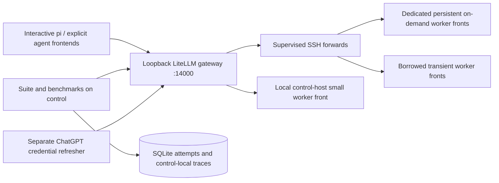

# Architecture

Status: core implementation overview. Recorded site selections and operational health live in each
installation's site repository; see [Evaluation and validation](testing.md),
[Model naming](model-naming.md), [Local management dashboard](dashboard.md),
[Development](development.md), and the [ADR index](adr/README.md).

## Ownership and deployment

AGENTIaC is a source-checkout tool for one operator's Ubuntu control host and heterogeneous
Linux workers, not a general cluster scheduler. Dedicated workers serve always-available
capacity; borrowed workers host explicit, bounded-lifetime claims; the control host may also
offer a small local inference profile. Machine facts live in `infra/inventory.yml`; model
and engine pins live in `profiles/` and `backends/`. `src/agentiac/declared.py` reads these
alongside component (`infra/components.yml`), retention (`infra/retention.yml`), route
(`gateway/`), and agent (`agents/agents.yml`) declarations as one graph and checks
references. No manifest reconciler runs
([ADR 0007](adr/0007-declared-and-runtime-state.md),
[ADR 0009](adr/0009-detect-and-propose-apply-by-approval.md)).

Ansible installs persistent systemd units and project-owned runtime files. Borrowed front,
worker, watch, and tunnel processes use the explicit claim/release path in
`scripts/borrow.py`; release stops project workloads while preserving the owner's other work.
Dedicated workers may use an explicit manifest backend while retaining their `default_profile`
for `ops start` rollback. Every operation that changes what is served (`claim`, `release`,
`reclaim`, `route`, `deploy`, and recovery timer `reclaim`) holds the single lock in
`mutation.py` and journals under `artifacts/locks/`. `claims.py` keeps control's record of
each claim under `artifacts/claims/`, which `ops drift` compares with live fronts. Selected
`local-coder` targets are runtime state, while the declared `default` fallback stays on a
dedicated worker.

Builds and downloads run on worker NVMe. Profiles pin source and weight hashes, and prepared
roots retain separate generations. `ops storage` measures project roots, separately pinned
checkpoints, images, and build caches; retention decisions stay separate from Docker's
reclaimable-byte accounting. `ops retire` gates root retirement and rehearses image
retirement without automatically authorizing deletion
([ADR 0008](adr/0008-two-generation-retention.md)). `infra/tasks/write-node-config.yml` is
the shared node configuration writer and preserves existing worker ports unless explicitly
overridden.

## Request and resource lifecycle

Inference endpoints and the gateway bind to loopback, reached over SSH forwards with strict
host-key checking and distinct protected worker credentials. Each backend sits behind
`scripts/ondemand-proxy.py`: an active, authenticated request loads it, runs admission
checks, waits for readiness, and forwards bytes ([ADR 0004](adr/0004-on-demand-serving.md)).
Passive health and metadata probes (`/health`, `/v1/models`, `/models`, `/props`, `/slots`,
`/metrics`) do not load it or extend its idle timer; an authenticated `X-Ondemand-Load: 1`
metadata request does. Idle unload, explicit unload/release, and noticing a stopped backend
are distinct paths.

Resource limits and admission are backend-specific. Unified-memory admission and worker
watches are not equivalent to Docker memory accounting, and GPU ownership checks on Jetson
use device/process evidence rather than assuming `nvidia-smi` reports memory accurately.
Preserve foreign workloads, private APIs, and the rule against automatic driver or JetPack
replacement.

## Routing and identity

LiteLLM provides stable aliases and protocol translation. A pre-call hook checks the served
model ID and, when configured, the front's backend ID, exact manifest hash, and context.
`scripts/route.py` renders the selected `local-coder` alias and target identities; runtime
route state stays in ignored artifacts, and a failed gateway restart restores the previous
selection. No weaker model is a silent inference fallback
([ADR 0002](adr/0002-evaluation-before-routing.md)). Callback node tables (alias to worker,
port to key, key to host) render from `gateway/config.yaml` and `infra/inventory.yml` to
`artifacts/gateway/nodes.json`.

`identities.py` computes declared `class_id` and `config_id` hashes; suite results carry
these alongside hardware identity (`hw_fp`), agent version, and checkout revision. The
optional explicit cloud alias (`cloud-gpt-sol`) requires the owner's ChatGPT sign-in, runs in
a separate refresher process, and never acts as a fallback
([ADR 0005](adr/0005-chatgpt-subscription-alias.md)). Automated agent adapters use the
restricted task key (`gateway/task_policy.py`) rather than the master key; interactive
`agentiac code` carries `LITELLM_CODE_KEY` (local aliases) or `LITELLM_CODE_CLOUD_KEY` (also
the cloud alias). Node-first short API aliases are resolved consistently by `route_aliases.py`
while preserving legacy target keys and historical case specifications
([Model naming](model-naming.md)).

## Evaluation, evidence and recovery

`Store` in `state.py` uses SQLite transactions, owner tokens, and attempt numbers for
resumable cases. Expired claims can be reclaimed without erasing earlier attempts. Suite
adapters (`adapters.py`) construct pinned frontend invocations, the executor owns container
lifecycle, and graders run without network against protected tests. Retries remain explicit
and are reported separately from first attempts ([Evaluation and validation](testing.md)).

Declared identity, historical evidence imports (`evidence.py`), failure classification
(`failures.py`), and non-acting `model recommend` are implemented. Recommendations propose and
never change a route. Detailed prompts, responses, and patches remain in ignored control
artifacts and are never committed. Set-B backup and restore (`backup.py`,
`scripts/restore-control.py`) preserve evaluation records while excluding credentials and
reproducible installs; SQLite uses a consistent snapshot, and restore verifies digests and
constrains extraction to `artifacts/` before rebuilding derived evidence. CI runs unit,
parsing, Ansible syntax, YAML/Ansible/shell lint, and publication checks without deployment
secrets ([Development](development.md)).

## Local management dashboard

The dashboard adds shared read services under `services/`, a separate authenticated loopback
FastAPI management API under `management/`, a static React UI in `dashboard/`, and a
minimal-probe worker under `operations/`. GET readers never start SSH or installed agent
binaries; declared data, full hardware provenance, and management probe snapshots remain
distinct, and response DTOs generate the OpenAPI/TypeScript contract.

`private/management/operations.sqlite` owns operational attempts, launch intent/handle
receipts, readiness, and minimal-probe snapshots independently of the evaluation `Store`.
An explicitly allowlisted foreground probe worker holds a control-host OS lock, executes a
fixed read-only Linux protocol, and requires named reconciliation before clearing unresolved
attempts. Engine catalogue lifecycle classification (`services/engine_catalog.py`) projects
per-node/backend uses from declarations and `backends/lifecycle.yml`. Management supports a
separate immutable release root, live declaration root, and private state root, with
single-use `dashboard plan`/`apply` operating only its two named user units. See
[Local management dashboard](dashboard.md).
