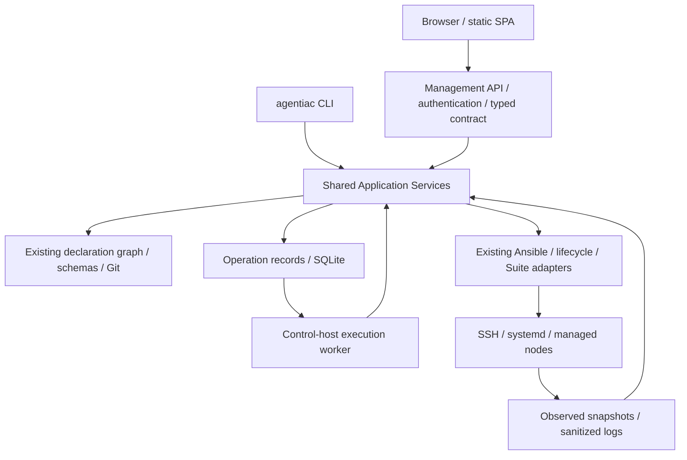

# Management dashboard design

Design architecture, security boundaries, operational job recovery, and Engines lifecycle UX
for the local management dashboard. See [Architecture](architecture.md#local-management-dashboard)
and [Local management dashboard](dashboard.md) for current implementation scope and operator
commands, and [ADR 0007](adr/0007-declared-and-runtime-state.md),
[ADR 0008](adr/0008-two-generation-retention.md), and
[ADR 0009](adr/0009-detect-and-propose-apply-by-approval.md) for foundational rules.

## Architecture and technology choices



- **Backend API**: Python 3.12 + FastAPI/Pydantic/Uvicorn pinned in `requirements-dashboard.lock`
  (`.venv-dashboard`), reusing Python declaration/catalog services and generating OpenAPI.
- **Frontend UI**: static React + TypeScript + Vite SPA (`dashboard/`), built to static assets
  and served same-origin by the management API (no separate SSR server or external hosting).
- **Shared Application Services (`src/agentiac/services/`)**: pure Python projection functions
  accepting injected roots/clocks/stores and returning DTOs without `print`, `argparse`,
  or HTTP assumptions.
- **Execution & ledger**: control-local SQLite WAL (`private/management/operations.sqlite`),
  separate from the evaluation `Store` and excluded from set-B backups
  ([Operations](operations.md)). No external workflow broker is introduced.

References: [FastAPI features](https://fastapi.tiangolo.com/features/),
[FastAPI background tasks](https://fastapi.tiangolo.com/tutorial/background-tasks/),
[React TypeScript](https://react.dev/learn/typescript),
[Vite backend integration](https://vite.dev/guide/backend-integration), and
[MDN Server-sent events](https://developer.mozilla.org/en-US/docs/Web/API/Server-sent_events/Using_server-sent_events).

## State model and IaC boundaries

Each managed resource distinguishes `desired`, `observed` (`value`, `source`,
`collected_at`, `expires_at`, `quality`, `error_code`), `drift`, `pending_changes`, and
`capabilities`. Quality values (`fresh`, `stale`, `unknown`, `unsupported`, `unavailable`)
never coerce uncollected fields to `0` or `offline`.

- Desired declarations remain split across Git-tracked files (`infra/inventory.yml`,
  `infra/components.yml`, `infra/retention.yml`, `profiles/`, `backends/`, `gateway/`,
  `agents/`) read as one graph by `declared.py`.
- Any future configuration/apply flow must validate the complete candidate graph in an
  isolated worktree, bind approvals to immutable plan hashes, serialize with the shared CLI
  mutation lock (`mutation.py`), and leave Git/DBs intact on failure without auto-reset or
  auto-apply ([ADR 0009](adr/0009-detect-and-propose-apply-by-approval.md)).
- Existing driver/JetPack `frozen` policies and shared-workload protections cannot be
  bypassed by UI roles.

## Operation jobs and recovery

Operational jobs follow an explicit state machine:

```text
queued -> running -> succeeded | failed | partial | interrupted | needs_attention
queued -> cancelled
running -> cancel_requested -> cancelled | partial | needs_attention
```

- **Idempotency & exclusivity**: requests key on idempotency key + actor + operation +
  normalized argument hash (`409` on mismatch). The foreground worker holds a control-host
  OS `flock` and SQLite transaction lease.
- **Durable receipts & fencing**: before remote execution, the worker records prelaunch
  intent, endpoint, local PID/start ticks, and remote nonce/code hash before sending `GO`.
  Lease expiry or SSH disconnect never authorizes automatic retry: unresolved attempts enter
  `needs_attention` and block new dequeues until named reconciliation verifies local and
  remote process absence.
- **Read-only GET guarantee**: GET endpoints never invoke SSH, Ansible, model loads, or
  installed agent binaries; minimal probes are explicit operator-approved POST jobs executed
  only when an allowlisted foreground worker is running.

## API and security boundaries

- **Typed contract**: Pydantic models under `management/dto.py` generate the OpenAPI schema
  and TypeScript client (`scripts/dashboard-schema.py --check` enforced in CI).
- **Pagination & errors**: list endpoints return `items`, `next_cursor` (keyset over stable
  sort + ID), and `as_of`; errors share `code`, `message`, `request_id`, `retryable`,
  `details` with `Cache-Control: no-store` and never echo tracebacks, secrets, argv, or
  checkout paths.
- **Network & auth**: loopback bind only (SSH tunnel HTTP or native loopback HTTPS with
  owner-only cert/key); CLI-initialized salted scrypt owner credentials; server-side opaque
  `HttpOnly` / `SameSite=Strict` session cookies (never in JSON or `localStorage`); per-role
  permission matrix (`viewer`, `operator`, `admin`), CSRF token + same-origin `Origin`/`Host`
  checks on mutations.
- **Secret isolation**: task containers never mount `private/management/` credentials,
  cookies, or sockets; read DTOs use strict allowlists.

## Engines lifecycle UX

The Engines view (`GET /api/v1/engines[/{id}]`, `services/engine_catalog.py`) explains why
each engine source release is declared or retained without triggering SSH, `ops storage`, or
`ops retire`.

### Separated axes and roles

Three independent axes stay visually distinct:

1. **Catalogue**: backend manifests and `backends/lifecycle.yml` (`declared` vs `archived`
   record—not proof of host installation).
2. **Declared uses by node**: `infra/retention.yml`, inventory defaults (`default_profile`,
   `strata_backend`, `strata_default_backend`), and route targets:
   - `Default` (`default`): ledger `serving` or inventory claim default (never called `Running`).
   - `Rollback` (`rollback`): ledger `rollback` (`form: thin` shows `Restore required`).
   - `Evaluation` (`evaluation`): ledger `candidate` (retained for evaluation, distinct from
     retirement cleanup).
   - `Quarantined` (`quarantined`): ledger `quarantine`.
   - `Retired record` (`retired`): historical ledger `retired` record.
   - `Declared only` (`declared_only`): target/component/pin present with no structured
     retention role.
   - `Needs review` (`issues`): missing references, ambiguous joins, or contradictory state.
3. **Runtime selection**: `local-coder selected` reads passive route state without claiming
   loaded-process attestation.

`retirement_intent` (`Cleanup proposed` for `candidate`, `Keep` for `declined`,
`Not specified` otherwise) stays independent of role.

### Sidecar `backends/lifecycle.yml` and manifest immutability

Adding lifecycle annotations must never modify `backends/*.json` bytes (which feed worker
identity guards, `class_id`, `config_id`, and `decl` digests). Instead, an optional sidecar
`backends/lifecycle.yml` validated by `infra/backend-lifecycle.schema.json` records
`catalog_status: declared | archived`, `reason`, `evidence`, and explicit `retention_refs`
(`node`, `state`, `handle`) for name-only ledger entries.

A release has `history_only: true` only when **all** its backends are explicitly `archived`,
held ledger states are zero, active target/default/component/current references are zero, and
join/classification issues are zero. Contradictions or dangling references surface as
`issues` / `lifecycle_issues` and keep `history_only: false`.

### Caching, filtering, URL state, and retirement guidance

- **Snapshot cache**: `services/engine_catalog.py` builds one 30 s per-process snapshot from
  a single `declared.load` graph plus passive route state. Failed rebuilds serve the prior
  snapshot marked `stale: true` (or `503` if none exists).
- **Default scope & filters**: initial scope `Declared & retained` hides only confident
  `history_only` releases (`History` badge when shown under `History only` or `All releases`).
  `Node` and `Use` filters match the same `(node, backend)` association rather than
  cross-matching across nodes.
- **URL & deep links**: `#/engines?scope=...&node=...&use=...&q=...` and `#/engines/{id}`
  preserve filters across browser history; direct links to hidden releases open details with
  a `Show in list` action.
- **Read-only guidance**: `Cleanup proposed` associations display a copyable read-only command
  (`agentiac ops retire <node> --backend <canonical-backend> --check`) with no destructive
  action buttons in the UI.
- **Accessibility & layout**: native labeled controls, `aria-expanded`/`aria-controls` and
  `aria-live=polite` updates, contrast compliance in light/dark themes, and card layout at
  narrow viewports without horizontal overflow.

See [Evaluation and validation](testing.md) and [Development](development.md) for test and
CI gates covering the dashboard contract and browser smoke suite.
